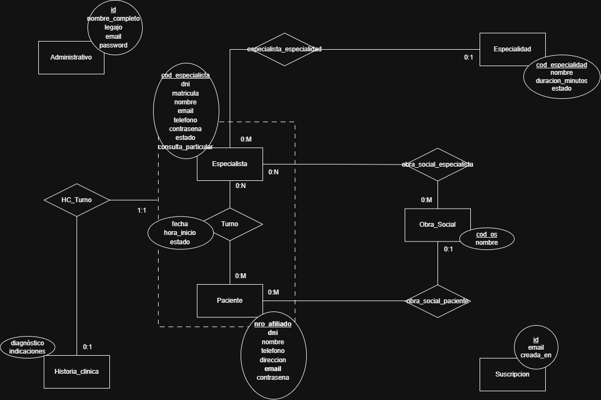

# Propuesta TP DSW

## Grupo

### Integrantes

- 48711 - Speranza, Facundo
- 50491 - Sampaulesi, Mateo
- 55366 - Cuadradas, Lucas
- 54826 - Cavestri, Elian
- 52509 - Alma García Morichetti

### Repositorios

- [frontend app](http://hyperlinkToGihubOrGitlab)
- [backend app](http://hyperlinkToGihubOrGitlab)

## Tema

### Descripción

_Es un sistema de una clinica que tiene diversos especialistas de diferentes especialidades en el cual el paciente pueda gestionar su propio turno acorde a la agenda del especialista deseado, los especialistas trabajan cada uno con distintas obra sociales_

### Modelo

## Alcance Funcional

Regularidad:
|Req|Detalle|
|:-|:-|
|CRUD simple|1. CRUD Paciente 2. CRUD Obra_Social 3. CRUD Especialidad  4.CRUD Especialista|
|CRUD dependiente|1. CRUD Turno {depende de} paciente y de especialista  2. CRUD historia_clinica {depende de} CRUD Turno|
|Listado + detalle| 1. Listado de especialistas filtrado por especialidad, muestra especialistas que tengan una determinada especialidad  2. Listado de turnos posibles filtrado por especialista, muestra horarios posibles para atenderse con un determinado especialista|
|CUU/Epic| 1. Solicitar un turno seleccionando especialidad, especialista, fecha y horario disponible. 2. Registrar la atención de un paciente, guardando diagnóstico e indicaciones en su historia clínica y marcando el turno como atendido.|

## Documentación API

La documentación interactiva de la API está disponible en el backend:

- Scalar UI: `http://localhost:3000/docs`
- OpenAPI JSON: `http://localhost:3000/openapi.json`

Si el backend corre en otro puerto, reemplazá `3000` por el puerto correspondiente.

Adicionales para Aprobación

| Req                     | Detalle                                                                                                                                                                                                                                                                                        |
| :---------------------- | :--------------------------------------------------------------------------------------------------------------------------------------------------------------------------------------------------------------------------------------------------------------------------------------------- |
| CRUD                    | 1. CRUD Paciente 2. CRUD Obra_Social 3. CRUD Especialidad  4.CRUD Especialista  5.CRUD Turno                                                                                                                                                                                    |
| Listado + detalle | 1. Listado de especialistas filtrado por especialidad, muestra especialistas que tengan una determinada especialidad  2. Listado de turnos posibles filtrado por especialista, muestra horarios posibles para atenderse con un determinado especialista                                     |
| CUU/Epic                | 1. Solicitar un turno seleccionando especialidad, especialista, fecha y horario disponible.  2.Confirmar asistencia a turno. 3. Cancelar turno 4.Registrar la atención de un paciente, guardando diagnóstico e indicaciones en su historia clínica y marcando el turno como atendido. |

### Alcance adicional voluntario

| Req      | Detalle                                                                                                  |
| :------- | :------------------------------------------------------------------------------------------------------- |
| Listados | -                                                                                                        |
| CUU/Epic | -                                                                                                        |
| Otros    | 1. Notificación por correo de asignación de turno 2.Recordatorio con confirmación un día antes del turno |

### Instalación y ejecución

Consultar el [instructivo de instalación](./docs/instrucciones%20de%20instalacion.md).
